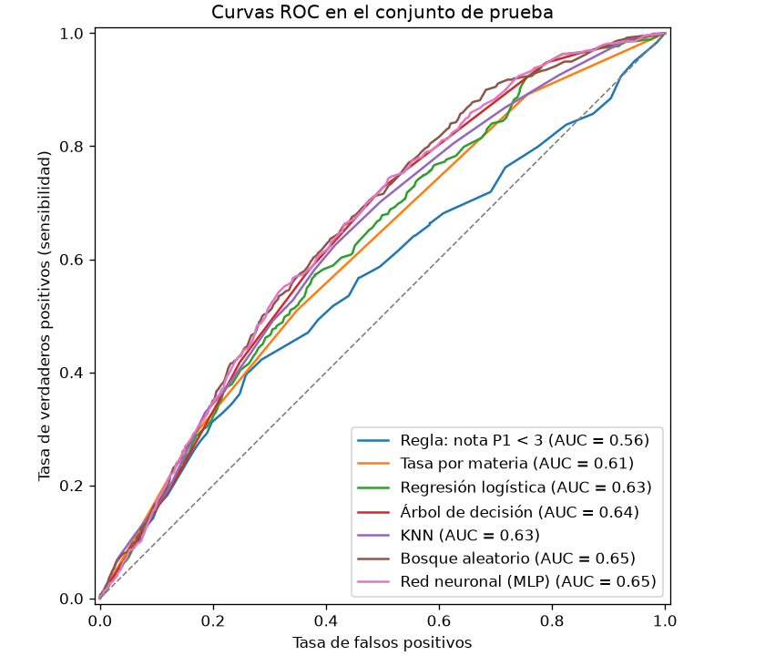
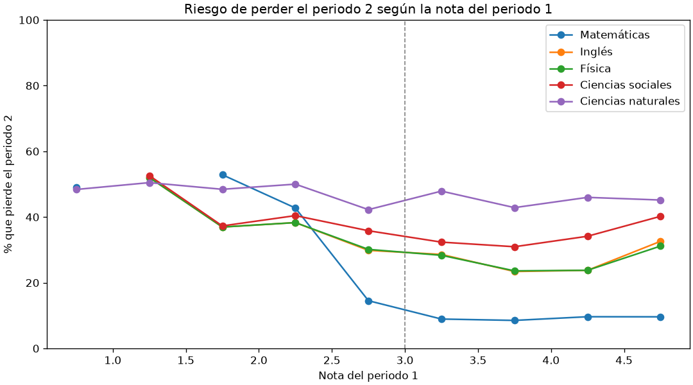

# Predicción de rendimiento académico

[](https://github.com/LegalmentePablo/prediccion-rendimiento-academico/actions/workflows/ci.yml)
[](https://colab.research.google.com/github/LegalmentePablo/prediccion-rendimiento-academico/blob/main/notebooks/analisis.ipynb)

[](LICENSE)

Sistema de **alerta temprana** que estima, al cerrar el primer periodo académico, qué estudiantes
tienen riesgo de perder una materia en el segundo. Compara cinco modelos, de la regresión logística
a una red neuronal, contra dos líneas base, con una evaluación agrupada por estudiante.

## Resumen de resultados

- **Los datos tenían problemas que nadie había revisado.** Las etiquetas de Ciencias naturales son
  aleatorias (coinciden con la nota solo en el 51 % de los casos) y varias materias comparten
  columnas copiadas.
- **Los modelos anticipan bastante más que la intuición.** Con solo la nota del periodo 1 y la
  materia, el árbol de decisión, la red neuronal y el bosque aleatorio detectan entre el **66 % y el
  73 %** de los estudiantes que perderán el periodo 2. La regla obvia «si perdió el periodo 1,
  perderá el periodo 2» detecta el **42 %**.
- **No es solo mover el umbral.** Si la regla se relaja a `nota < 4`, llega a una sensibilidad
  parecida (68 %), pero su precisión cae a 0,35. Los modelos la mantienen en ~0,41.
- **El mejor equilibrio** lo dan el bosque aleatorio (AUC 0,654), la red neuronal (0,651) y el
  árbol de decisión (0,644, el más simple y el que más casos detecta). Las líneas base quedan en
  0,613 (solo la materia) y 0,561 (solo la regla de la nota).
- **De cada 5 alertas, unas 2 aciertan.** Sirve para priorizar tutorías y seguimiento, no para
  tomar decisiones con consecuencias.
- **Matemáticas concentra la señal:** es la única materia donde la nota del periodo 1 anticipa
  claramente la del periodo 2 (correlación 0,40, frente a 0,04–0,16 en las demás).

## Contexto

Lo hice durante la universidad, en 2023, como proyecto académico de aprendizaje automático. La
versión original era un notebook de Google Colab que leía las notas desde Google Drive y probaba
varios modelos: regresión logística, regresión lineal, árboles de decisión, KNN, una red neuronal
de scikit-learn y una red profunda en TensorFlow.

Este repositorio es esa misma idea **revisada y reconstruida** años después con prácticas de
ingeniería que entonces no aplicaba: código modular, pruebas automáticas, integración continua y,
sobre todo, una metodología de evaluación más rigurosa. El notebook original se conserva en
[`notebooks/original/`](notebooks/original/) para comparar el antes y el después.

## Mejoras respecto a la versión de 2023

| Antes | Ahora |
|---|---|
| Clasificación de periodos ya calificados | Predicción **anticipada**: el periodo 2 a partir de lo que se sabe al cerrar el periodo 1 |
| SMOTE sobre el conjunto completo | SMOTENC dentro del pipeline, aplicado solo al entrenamiento |
| Evaluación sobre una única partición | Validación cruzada de 5 pliegues más una prueba final apartada |
| División por filas | División **agrupada por estudiante** |
| Regresión lineal adaptada a clasificación | Regresión logística, que da probabilidades válidas |
| Modelos comparados entre sí | Comparados también con dos líneas base: la regla de la nota y la tasa por materia |
| 128 celdas con bloques repetidos por modelo y periodo | Paquete de 6 módulos (~480 líneas con documentación) y un notebook de 16 celdas |
| Datos en Google Drive | Datos dentro del repositorio; corre en local y en Colab |
| Sin revisión de calidad de datos | Reporte de calidad; las etiquetas de Ciencias naturales se recalculan desde la nota (ver [`data/`](data/README.md)) |
| Sin pruebas | Pruebas automáticas e integración continua en Python 3.11–3.13 |

## Resultados

Conjunto de prueba (20 % de los estudiantes, nunca vistos durante el entrenamiento). La clase
positiva es «pierde el periodo 2».

| Modelo | AUC ROC | Exactitud balanceada | Sensibilidad | Precisión | F1 |
|---|---:|---:|---:|---:|---:|
| Bosque aleatorio | **0,654** | **0,614** | 0,660 | 0,421 | 0,514 |
| Red neuronal (MLP) | 0,651 | 0,613 | 0,702 | 0,412 | 0,519 |
| Árbol de decisión | 0,644 | 0,613 | **0,726** | 0,408 | **0,523** |
| KNN | 0,635 | 0,556 | 0,269 | **0,448** | 0,336 |
| Regresión logística | 0,625 | 0,594 | 0,579 | 0,414 | 0,482 |
| *Línea base: tasa por materia* | *0,613* | *0,580* | *0,509* | *0,410* | *0,454* |
| *Línea base: nota P1 < 3* | *0,561* | *0,568* | *0,422* | *0,412* | *0,417* |

El mejor modelo se elige por AUC en la validación cruzada (árbol de decisión, 0,666), nunca
mirando la prueba. Los hiperparámetros se fijaron de antemano, sin búsqueda.

<p align="center">
  
  
</p>

**Cómo leerlo:**

- Buena parte de la ventaja viene de saber la materia: la tasa por materia sola ya logra un AUC
  de 0,613. La nota del periodo 1 añade unos 0,04 más.
- Con solo dos variables, un árbol de profundidad 4 rinde casi igual que un bosque aleatorio o una
  red neuronal: no hay más patrón que aprender.
- KNN es el más conservador: marca a pocos estudiantes (sensibilidad de 0,27), así que no sirve
  como alerta.
- La señal útil viene sobre todo de Matemáticas. En Ciencias sociales y Ciencias naturales las
  notas de los dos periodos casi no están relacionadas.

## Estructura

```
├── data/raw/                 CSV originales, uno por materia (anónimos)
├── notebooks/
│   ├── analisis.ipynb        Análisis completo, ejecutable en local o en Colab
│   └── original/             Notebook de 2023, archivado sin cambios de lógica
├── reports/                  Tablas (.csv) y figuras (.png) generadas
├── src/prediccion_rendimiento/
│   ├── config.py             Constantes: nota aprobatoria, materias, semilla
│   ├── datos.py              Carga, validación y reporte de calidad
│   ├── modelos.py            Catálogo de modelos y líneas base
│   ├── evaluacion.py         División por estudiante, validación cruzada, prueba y `analizar()`
│   ├── graficos.py           Figuras
│   └── cli.py                Flujo completo desde la terminal
└── tests/                    Pruebas con pytest
```

## Cómo ejecutarlo

**En Colab:** abre el notebook con el botón de arriba y ejecuta todas las celdas. La primera
descarga el proyecto e instala lo necesario.

**En local**, con [uv](https://docs.astral.sh/uv/):

```bash
git clone https://github.com/LegalmentePablo/prediccion-rendimiento-academico.git
cd prediccion-rendimiento-academico
uv sync
uv run prediccion-rendimiento                  # regenera reports/ y muestra las métricas
uv run --with jupyterlab jupyter lab notebooks/  # opcional: abrir el notebook
```

Con `pip`: `pip install -e .` y después `prediccion-rendimiento`. Por defecto el comando lee
`data/raw` y escribe en `reports`, así que debe ejecutarse desde la raíz del repositorio; desde
otra carpeta, indica las rutas con `--datos` y `--salida`.

**Pruebas y estilo:**

```bash
uv run pytest
uv run ruff check . && uv run ruff format --check .
```

## Limitaciones

Los datos muestran señales de ser sintéticos o de haberse armado copiando columnas (detalle en
[`data/README.md`](data/README.md)). El proyecto vale como ejercicio metodológico: cómo plantear
y evaluar bien un modelo de alerta temprana. Con datos reales y más variables, como asistencia,
historial u otras materias, los resultados podrían ser muy distintos.

## Licencia

[MIT](LICENSE).
